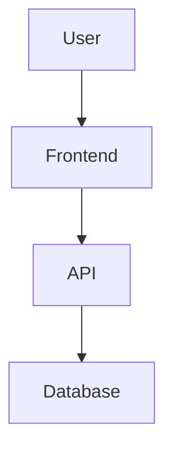

# Diagrams Documentation

This directory contains architectural and technical diagrams for the MyBoardPrep Collaborative Learning Suite.

## Diagram Types

### System Architecture

High-level system architecture diagrams showing:
- Frontend and backend components
- Service interactions
- Data flow
- External integrations

### Database Schema

Database diagrams showing:
- Table relationships
- Entity relationships
- Index structures
- Data flow

### Component Architecture

Frontend component diagrams showing:
- Component hierarchy
- State management
- Data flow
- Component relationships

### Real-time Collaboration

Diagrams showing:
- Yjs document synchronization
- WebSocket connections
- Presence management
- Conflict resolution

### User Flows

User journey diagrams showing:
- Authentication flow
- Room creation flow
- Document collaboration flow
- AI assistant interaction flow

### Deployment Architecture

Infrastructure diagrams showing:
- Deployment environments
- Service scaling
- Network configuration
- Security architecture

## Diagram Formats

- **Mermaid**: Text-based diagrams (embedded in markdown)
- **Draw.io**: Editable diagram files
- **PNG/JPG**: Exported images for documentation
- **SVG**: Scalable vector graphics

## Naming Convention

Use descriptive names with hyphens:

```
system-architecture.mmd
database-schema.drawio
user-flow-authentication.png
component-hierarchy-collaboration.svg
```

## Creating Diagrams

### Mermaid Diagrams

Create diagrams using Mermaid syntax in markdown files:

```markdown

```

### Draw.io

1. Download Draw.io: https://app.diagrams.net/
2. Use the provided templates
3. Export in multiple formats
4. Commit both source and exported files

## Diagram Maintenance

- Keep diagrams updated with code changes
- Use version control for diagram files
- Document diagram updates in changelog
- Review diagrams during architecture reviews

## Current Diagrams

- [ ] System Architecture
- [ ] Database Schema
- [ ] Component Hierarchy
- [ ] Real-time Synchronization Flow
- [ ] Authentication Flow
- [ ] Deployment Architecture
- [ ] Network Configuration
- [ ] Security Architecture

## Diagram Standards

### Color Scheme

Use consistent colors across diagrams:
- Blue: Frontend components
- Green: Backend services
- Purple: Database
- Orange: External services
- Gray: Infrastructure

### Style Guidelines

- Use consistent font sizes
- Maintain clear spacing
- Use standard symbols
- Include legends when needed
- Label all connections clearly

## Diagram Reviews

Diagrams should be reviewed:
- Before major releases
- After architectural changes
- During onboarding of new team members
- When creating documentation

## Exporting Diagrams

When exporting diagrams:
- Export in multiple formats (PNG, SVG)
- Use high resolution for PNG (300 DPI)
- Include alt text for accessibility
- Optimize file size for web

## Diagram Tools

### Recommended Tools

- **Mermaid**: Text-based diagrams
- **Draw.io**: Free, web-based diagramming
- **Lucidchart**: Professional diagramming
- **Figma**: UI/UX diagrams and flows
- **Excalidraw**: Hand-drawn style diagrams

### Installation

```bash
# Mermaid CLI
npm install -g @mermaid-js/mermaid-cli

# Draw.io desktop
brew install --cask drawio
```

## Diagram Integration

Diagrams can be integrated into:
- Main documentation files
- Feature documentation
- API documentation
- Architecture documentation
- Onboarding materials

## Diagram Storage

- Source files: Keep in this directory
- Exported images: Keep in this directory
- Embedded diagrams: Use in markdown files
- External hosting: Use for large diagrams

## Diagram Versioning

- Track changes in git
- Use descriptive commit messages
- Maintain diagram history
- Document significant changes

## Accessibility

- Provide text descriptions
- Use high contrast colors
- Include alt text for images
- Ensure diagrams are readable

## Contributing

When adding new diagrams:
1. Follow naming conventions
2. Use standard tools
3. Export in multiple formats
4. Update this README
5. Document the diagram purpose
6. Review with the team

## Questions or Issues

For questions about diagrams:
- Check existing diagrams for patterns
- Consult with the architecture team
- Use recommended tools
- Follow established conventions
