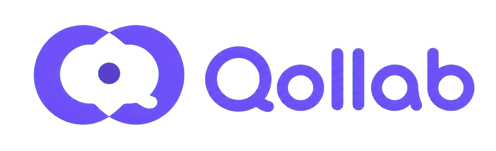

# Qollab Logo

## Brand idea

The Qollab logo represents people bringing questions, ideas, and knowledge into one shared space. Its visual system combines collaboration, curiosity, and continuous learning in a friendly minimalist form.

## Meaning of each element

### Interlocking loops

The two violet loops represent two people, groups, or perspectives meeting as equals. Their overlap communicates collaboration rather than one-way instruction. Because the loops remain connected, they also suggest an ongoing cycle of sharing, feedback, and improvement.

### Hidden letter Q

The negative space forms a subtle **Q**, connecting the symbol directly to the Qollab name. The Q also stands for **questions**, reflecting the way meaningful collaboration often begins with curiosity.

### Speech-bubble tail

The small opening and rounded tail on the lower-right side turn the inner Q into a speech bubble. This represents discussion, Q&A, feedback, and the exchange of ideas inside a shared workspace.

### Central dot

The dot at the center represents the shared focus of a group: an idea, lesson, problem, or goal. It can also be read as a person surrounded by a supportive learning community.

### Rounded geometry

Soft, rounded forms make the identity approachable and inclusive. They balance the logo's precise construction with a welcoming personality suitable for students, educators, and teams.

### Violet color

Violet combines the calm reliability of blue with the imagination and energy associated with purple. For Qollab, it communicates:

- Thoughtful learning
- Creativity and discovery
- Trust and focus
- A modern digital experience

The primary brand violet is **Qollab Violet (`#6D50F7`)**, supported by **Deep Violet (`#4B2BBF`)** and **Soft Violet (`#EEE9FF`)**. The subtle tonal movement in the logo adds depth while preserving its minimalist character.

### Wordmark

The rounded **Qollab** wordmark visually echoes the circular forms in the symbol. Its friendly construction feels modern without appearing overly technical.

The paired vertical strokes in the middle suggest people or pillars standing side by side, reinforcing cooperation and shared responsibility. The repeated rounded counters create rhythm and make the wordmark feel connected to the looping mark.

## Logo formats

### Full lockup

Use the complete symbol and wordmark in navigation headers, authentication screens, presentations, and other places where the brand name should be immediately recognizable.

Asset: [`public/brand/qollab-logo-lockup.png`](public/brand/qollab-logo-lockup.png)

### Symbol only

Use the standalone interlocking-Q symbol when space is limited, including browser favicons, app icons, avatars, and compact controls.

Assets:

- [`public/brand/qollab-mark.png`](public/brand/qollab-mark.png)
- [`src/app/icon.png`](src/app/icon.png)
- [`src/app/apple-icon.png`](src/app/apple-icon.png)

## Usage guidelines

- Preserve the logo's original proportions; never stretch or compress it.
- Keep enough clear space around the logo for the interlocking shape to remain distinct.
- Use the transparent asset over simple, high-contrast backgrounds.
- Avoid placing the violet logo over visually busy imagery.
- Do not separate, rotate, redraw, or rearrange elements within the lockup.
- Do not add outlines, heavy shadows, or unrelated colors.
- Use the full lockup at approximately **160 × 49 pixels** or larger in interface headers.
- Use the symbol-only version at very small sizes where the wordmark would become unreadable.

## Accessibility

When the logo is the only content inside a navigation link, give the link an accessible name such as **“Qollab rooms”** or **“All study rooms.”** Treat the logo image itself as decorative to avoid announcing the brand twice.

For documents or marketing pages where the logo conveys content, use the alternative text **“Qollab.”**

## Brand summary

**Two perspectives connect around one shared idea, forming a Q for questions and a speech bubble for collaboration.**
